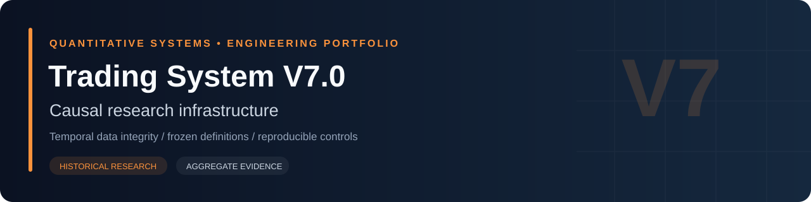
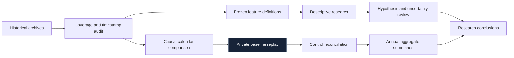

# Trading System V7.0

**Testing whether a research result survives correct information timing.**

Built an offline workflow for causal calendar comparisons, data-quality checks, frozen feature definitions and descriptive research. Preserved controls and separately labeled sensitivities make the effect of data assumptions visible.

| Project lens | Evidence type | Implementation | Public artifacts |
|---|---|---|---|
| Causal research infrastructure | Historical simulation and preserved audits | Private | Architecture, methods, aggregate results |

**Explore:** [System design](docs/ENGINEERING.md) · [Measurement methodology](docs/METHODOLOGY.md) · [Detailed results](docs/RESULTS.md) · [Machine-readable metrics](metrics.json)

## The engineering problem

A historical dataset can contain information unavailable at the decision time. Calendar selection, missing initial history and feature availability can alter a replay even when the trading policy itself is unchanged.

## System at a glance

The diagram is a conceptual view of the research workflow. It describes logical responsibilities, not a deployment topology or an executable trading specification.

## Engineering dimensions

| Dimension | What the project examines | Why it matters |
|---|---|---|
| Temporal integrity | Which information exists at each research step | Reduces future-information leakage |
| State evolution | How earlier events affect later eligibility and equity | Prevents treating dependent decisions as isolated observations |
| Execution assumptions | Costs, adverse marks and minute-bar limitations | Makes reported performance interpretable |
| Measurement | Consistent position counts, net results and drawdown definitions | Avoids misleading headline comparisons |
| Evidence discipline | Preserved snapshots, controls and explicit limitations | Separates reproducible output from unsupported claims |

## Historical evidence snapshot

**Inherited baseline reproduced within V7 causal-calendar research.** Each year starts a fresh simulation state. Declared and stress rows are alternatives, not separate periods to combine. These are not measurements of a new regime-filtered strategy.

| Available research period | Scenario | Net P&L | Maximum drawdown* | Positions |
|---|---|---:|---:|---:|
| 2024-01-03–2024-12-31 | Declared | -$1,597.88 | $2,264.68 | 93 |
| 2024-01-03–2024-12-31 | Stress | -$1,777.88 | $2,432.68 | 93 |
| 2025-01-02–2025-12-31 | Declared | -$71.08 | $1,581.44 | 128 |
| 2025-01-02–2025-12-31 | Stress | -$633.48 | $1,633.44 | 128 |
| 2026-01-02–2026-10-01 | Declared | $12,143.66 | $1,934.00 | 53 |
| 2026-01-02–2026-10-01 | Stress | $11,980.66 | $1,969.00 | 53 |

\* Maximum drawdown uses the highest prior end-of-day equity minus adverse intraday marked equity, not the highest intraday equity. Net P&L is after the modeled costs described in [Methodology](docs/METHODOLOGY.md). No new replay was run for this presentation update.

## A finding that changed the interpretation

The investigated market-condition hypotheses remained inconclusive. Reporting that finding, alongside negative years, is part of the engineering result; the research does not establish a validated improvement.

## Evidence and boundaries

| Supported here | Not established by this showcase |
|---|---|
| Aggregate figures checked against preserved research artifacts | Future returns or independent out-of-sample effectiveness |
| Explicit historical cost and drawdown definitions | Tick-accurate fills, latency or queue priority |
| Separately labeled sensitivity scenarios | Complete operational reliability |
| High-level engineering responsibilities | A reproducible public trading policy |

The public material omits implementation details and decision logic. No prospective paper or live results are published. Research-period selection and model uncertainty remain material limitations.

## Reading guide

- **[Engineering](docs/ENGINEERING.md):** component responsibilities, logical data contracts, sequencing and assurance gaps.
- **[Methodology](docs/METHODOLOGY.md):** metric definitions, effective cost assumptions and interpretation limits.
- **[Results](docs/RESULTS.md):** complete preserved tables and derived comparisons.
- **[Metrics JSON](metrics.json):** compact, machine-readable aggregate values.

## Portfolio context

[Version 2.0](https://github.com/miahaa/trading-system-v2-showcase) · [Version 3.0](https://github.com/miahaa/trading-system-v3-showcase) · [Version 4.0](https://github.com/miahaa/trading-system-v4-showcase) · [Version 7.0](https://github.com/miahaa/trading-system-v7-showcase)

These projects use different configurations, datasets and research objectives. Their results are not a controlled version ranking. Historical simulation results do not predict future returns.
