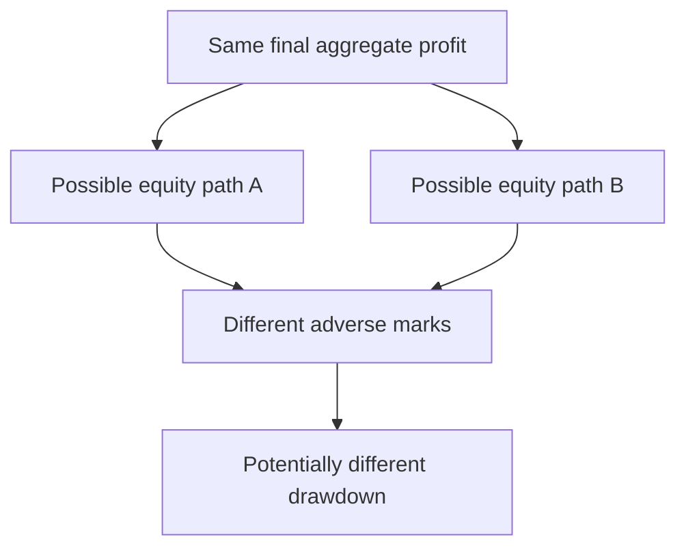

# Measurement methodology

## Research design

The public results are historical simulations checked against preserved report/summary artifacts. A new replay was not performed for this presentation. The evidence supports the reported historical arithmetic within its specified assumptions; it does not establish future profitability, exact executable fills or an operational reliability guarantee.

## Metrics and units

| Measure | Definition | Important distinction |
|---|---|---|
| Net P&L | Sum of closed whole-position net outcomes after modeled costs | Not gross profit or a prospective income estimate |
| Closed positions | Number of completed simulated positions | Not the count of executions or partial legs |
| Win rate | Positive-net closed positions divided by all closed positions | A profitable partial leg cannot make a negative-net position a win |
| Profit factor | Sum of positive position net results divided by absolute sum of negative position net results | Undefined if there are no losses; never assumed infinite evidence of reliability |
| Mean net per position | Net P&L divided by closed-position count | A descriptive sample average, not a predicted payoff |
| End-of-day drawdown | Highest completed end-of-day equity minus a later end-of-day equity | Excludes the adverse intraday marks used by the headline measure |
| Headline drawdown | Highest prior completed end-of-day equity minus adverse intraday marked equity, maximized over the replay | Does not use the highest intraday equity |

Win rate and profit factor appear only where the published evidence supports them. Listing a definition does not imply a missing metric has been measured.

For position net outcomes `p`, the descriptive arithmetic is:

```text
net P&L            = sum(p)
win rate           = count(p > 0) / number of closed positions
profit factor      = sum(p where p > 0) / abs(sum(p where p < 0))
mean net/position  = net P&L / number of closed positions
```

These are reporting definitions, not decision rules. Drawdown additionally requires an equity path; it cannot be reconstructed from final net P&L and a position count alone.

## Why final profit is insufficient



The diagram is conceptual. No synthetic path is presented as a measured equity curve. The public charts use only the verified aggregate values; no trade-level timing or reconstructed curve is published.

## Measurement and assumptions

- All figures are USD from historical minute-bar research replays, after modeled costs. The research paths continue through the available period rather than terminating at an operational risk event, so they are not realizable earnings claims.
- **Maximum drawdown*** is the largest decline from the highest previously completed end-of-day equity to adverse intraday marked equity. It does not use the highest intraday equity.
- Declared costs: micro gold commission $1.92 per contract round trip with two ticks of modeled exit slippage; micro index commission $1.40 per contract round trip with zero modeled stop slippage. Stress retains those commissions and increases slippage to four gold ticks and two index ticks. It does not stress every possible execution cost.
- Dates show each replay calendar’s available coverage. Coverage is not a guarantee that every minute or session was eligible. Missing or incomplete data and inherited exclusions affect the opportunity set. The base 2026 causal run abstains when initial prior-session history is unavailable; a separately documented warm-up sensitivity is excluded here.
- Earlier years are negative. The positive partial-year 2026 result is concentrated and does not establish a reliable future edge. All periods had already been inspected during research; none is a new untouched holdout.
- Figures were cross-checked between preserved per-year summaries and the calendar-impact comparison. No fresh replay was run for this showcase. Win rate, profit factor and equity curves are not published here because their complete public measurement evidence has not been prepared. No prospective paper or live performance is published.

## Scenario comparison rules

- Compare each alternate scenario with its matching version and research period.
- Report changes in both net P&L and drawdown; a lower final result does not imply a proportionally higher drawdown.
- Separate calendar changes from execution-cost changes where the preserved experiment does so.
- Keep independently reset annual runs separate. Do not combine them into a compounded return series.
- Treat inspected development periods as inspected, even if a later analysis freezes some definitions.
- Do not infer statistical significance from a difference in two aggregate values. No confidence interval is manufactured from these summaries.

## Reproducibility boundary

The public layer provides machine-readable aggregates, explicit definitions and labeled scenarios. It is not a complete public replication package: the implementation and detailed research inputs remain private. The showcase review checked consistency of preserved metrics and the presentation, rather than rerunning or certifying the entire underlying experiment.

## Evidence still needed

Tick-sequence and execution validation, broader independent data, prospective observations and integration parity require their own evidence. No paper/live track record, annualized return, Sharpe ratio or inferred equity curve is added here. Unpublished measurements should not be interpreted as zero or as favorable results.

[Overview](../README.md) · [Engineering](ENGINEERING.md) · [Results](RESULTS.md)
