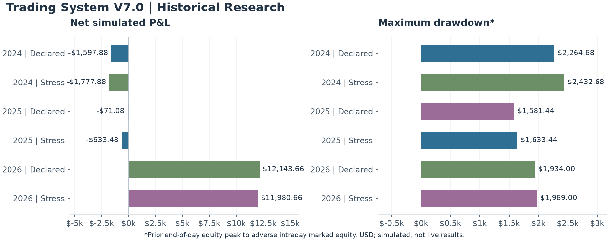

# Results and sensitivity analysis

## Historical research results

The table measures the **inherited baseline replayed within V7 research**, using the base causal calendar. It does not measure a new regime-filtered strategy or claim an improvement from the classifier. Each year is an independent run with a fresh simulation state; these are not a continuous compounded track record. Declared and stress rows are alternative cost scenarios.

| Available research period | Costs | Net P&L | Maximum drawdown* | Trades |
|---|---|---:|---:|---:|
| 2024-01-03–2024-12-31 | Declared | -$1,597.88 | $2,264.68 | 93 |
| 2024-01-03–2024-12-31 | Stress | -$1,777.88 | $2,432.68 | 93 |
| 2025-01-02–2025-12-31 | Declared | -$71.08 | $1,581.44 | 128 |
| 2025-01-02–2025-12-31 | Stress | -$633.48 | $1,633.44 | 128 |
| 2026-01-02–2026-10-01 | Declared | $12,143.66 | $1,934.00 | 53 |
| 2026-01-02–2026-10-01 | Stress | $11,980.66 | $1,969.00 | 53 |

## Measurement and assumptions

- All figures are USD from historical minute-bar research replays, after modeled costs. The research paths continue through the available period rather than terminating at an operational risk event, so they are not realizable earnings claims.
- **Maximum drawdown*** is the largest decline from the highest previously completed end-of-day equity to adverse intraday marked equity. It does not use the highest intraday equity.
- Declared costs: micro gold commission $1.92 per contract round trip with two ticks of modeled exit slippage; micro index commission $1.40 per contract round trip with zero modeled stop slippage. Stress retains those commissions and increases slippage to four gold ticks and two index ticks. It does not stress every possible execution cost.
- Dates show each replay calendar’s available coverage. Coverage is not a guarantee that every minute or session was eligible. Missing or incomplete data and inherited exclusions affect the opportunity set. The base 2026 causal run abstains when initial prior-session history is unavailable; a separately documented warm-up sensitivity is excluded here.
- Earlier years are negative. The positive partial-year 2026 result is concentrated and does not establish a reliable future edge. All periods had already been inspected during research; none is a new untouched holdout.
- Figures were cross-checked between preserved per-year summaries and the calendar-impact comparison. No fresh replay was run for this showcase. Win rate, profit factor and equity curves are not published here because their complete public measurement evidence has not been prepared. No prospective paper or live performance is published.

## Engineering focus

- Causal input selection and complete-window data-quality checks.
- Frozen feature definitions with traceable research artifacts.
- Control reproduction and independently labeled sensitivity analysis.
- Statistical analysis that reports sparse cohorts and inconclusive findings.

The research did not establish the proposed market-condition hypotheses as validated trading improvements. This project demonstrates research discipline and software validation, not a promoted trading system.

## Cost-scenario differences

Each line below compares stressed costs with declared costs within the same independently reset annual replay. No years are pooled or compounded.

| Independent run | Stress minus declared net P&L | Stress minus declared drawdown |
|---|---:|---:|
| 2024 | -$180.00 | $168.00 |
| 2025 | -$562.40 | $52.00 |
| 2026 | -$163.00 | $35.00 |

These deltas describe this replay and its cost assumptions. They do not isolate every source of uncertainty or measure a new trading policy. Different years have different data coverage and market conditions.

[Project overview](../README.md) · [Engineering](ENGINEERING.md) · [Methodology](METHODOLOGY.md)
